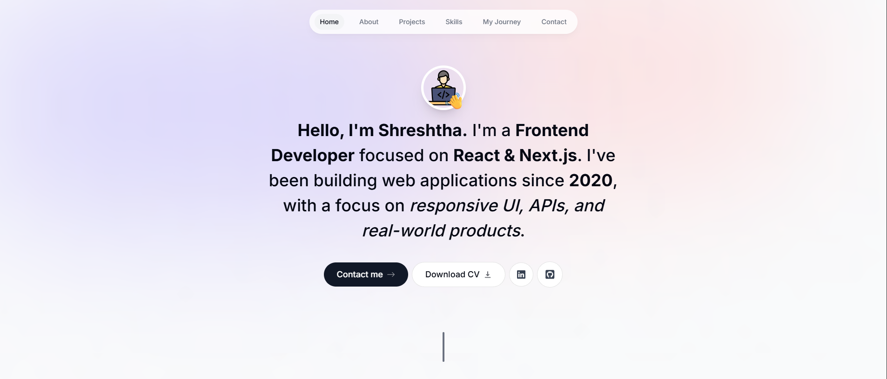

# Personal Portfolio

A modern, responsive developer portfolio built with [Next.js](https://nextjs.org/) to showcase my projects, technical skills, and experience.

🔗 **Live Demo:** https://shreshtha.vercel.app/

 *(Replace with a screenshot of your homepage)*

---

## ✨ Features

- **Responsive Design:** Optimized for desktop, tablet, and mobile screens.
- **Project Showcase:** Detailed cards with live demo links, GitHub repositories, and tech stack tags.
- **Performance Optimized:** Built on Next.js App Router with automatic font optimization (`next/font`).
- **Contact Integration:** Easy way for recruiters and collaborators to get in touch.
- **Dark/Light Mode:** *(Optional: Remove if not implemented)* Seamless theme switching.

---

## 🛠️ Tech Stack

- **Framework:** [Next.js](https://nextjs.org/) (App Router)
- **Language:** [TypeScript](https://www.typescriptlang.org/)
- **Styling:** [Tailwind CSS](https://tailwindcss.com/) *(or CSS Modules / Styled Components)*
- **Deployment:** [Vercel](https://vercel.com/)

---

## 🚀 Getting Started

Follow these steps to run the project locally on your machine:

### Prerequisites

Make sure you have [Node.js](https://nodejs.org/) (v18 or higher) installed.

### Installation

1. **Clone the repository:**
   ```bash
   git clone [https://github.com/afkshreshtha/portfolio.git](https://github.com/afkshreshtha/porfolio.git)
   cd portfolio
